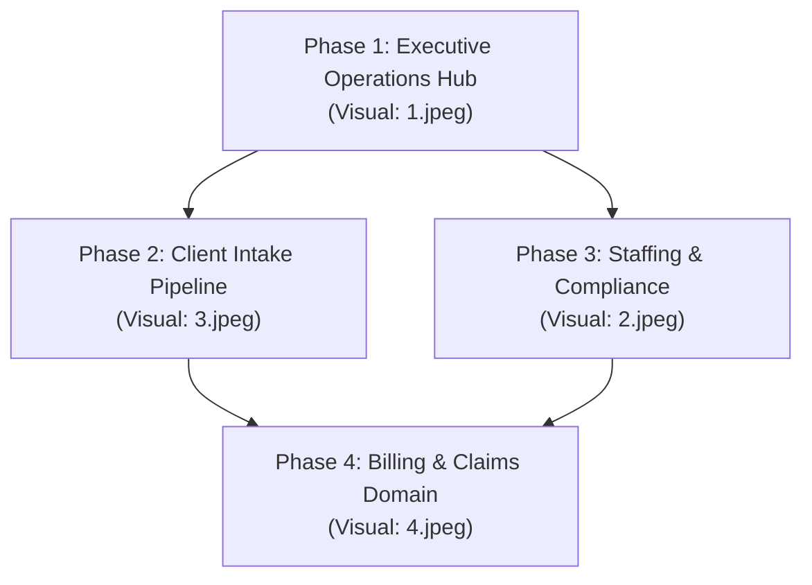

# Specification: Unified Administrative Operations Hub (SharePoint Dashboard Parity)

- **Spec ID:** `SPEC-ADMIN-001`
- **Status:** Draft / Ready for Review
- **Author:** Engineering & Architecture
- **Date:** 2026-10-11
- **Visual References:** `pics/1.jpeg` (Main Hub), `pics/2.jpeg` (Staffing), `pics/3.jpeg` (Client Intake), `pics/4.jpeg` (Billing & Claims)
- **Target Application:** Caregiver Platform (React 19 + Vite frontend, FastAPI backend, Supabase Postgres/Auth/Storage)

---

## 1. Executive Summary & Objective

Administrative leadership currently relies on a Microsoft SharePoint intranet portal (*"With Open Arms Home Care"*) for day-to-day operations across Georgia, Indiana, and Florida. Stakeholders have supplied visual captures (`pics/1.jpeg`–`4.jpeg`) establishing the expected dashboard experience.

This specification defines a **Spec-Driven Development (SDD)** plan to build native dashboard parity into the Caregiver platform's Admin portal (`/admin/*`). It translates the visual presentation and clinical workflows from the SharePoint screenshots into our modern React/FastAPI architecture while enforcing multi-state data boundaries, HIPAA compliance, and performance rules.

---

## 2. Gap Analysis: Current Application vs. SharePoint Reference

| Dimension | Current App (`/admin`) | SharePoint Reference (`pics/`) | Gap / Action Required |
|---|---|---|---|
| **Overview Hub ([1.jpeg](file:///C:/Users/user/Documents/Caregiver/pics/1.jpeg))** | 4 static KPI cards, 2 navigation links | Central hub with sub-portal tiles, recent intake roster, action task list, quick links, announcements, upcoming events | Complete UI overhaul of `/admin/dashboard` with dynamic aggregations |
| **Client Intake ([3.jpeg](file:///C:/Users/user/Documents/Caregiver/pics/3.jpeg))** | Tabular list of referrals in `/admin/referrals` | 4-stage pipeline (New, In Progress, Pending Docs, Completed), conversion rate charts, source & payer breakdowns, document checklist | Transform Referrals into a Kanban pipeline + add intake metrics endpoint |
| **Staffing & HR ([2.jpeg](file:///C:/Users/user/Documents/Caregiver/pics/2.jpeg))** | Caregiver table + document approval queue | Shift tracking (scheduled, filled, open, call-outs), availability breakdown, credential expiration alerts | Credential alerts can be derived today; shift/scheduling requires new schema or integration |
| **Billing & Claims ([4.jpeg](file:///C:/Users/user/Documents/Caregiver/pics/4.jpeg))** | ❌ No billing or claims features | Claims submitted, amount billed, aging AR (30/60/90 days), payer distributions | Requires new database domain or external clearinghouse sync |

---

## 3. Architecture & Security Requirements

1. **State Authorization Boundary:**
   - Platform serves Florida (`FL`), Indiana (`IN`), and Georgia (`GA`).
   - `administrator`: Strictly scoped to their assigned state via `scope_query()` and `assert_permitted_filter()`.
   - `super_admin`: Full multi-state access (`state=all` or specific state dropdown).
   - Backend **never** trusts client-supplied state IDs.
2. **Query Performance (Strict adherence to AGENTS.md):**
   - Explicit column naming — zero `select("*")`.
   - All aggregations (counts, sums) executed inside PostgreSQL via `.rpc()` or `count="planned"` / `count="exact"`.
   - Bounded round trips: Dashboard overview resolved in ≤ 3 round trips.
   - Partial indexes utilized: `(state_id, created_at) WHERE deleted_at IS NULL`.
3. **Frontend Data Standards:**
   - Reads must use `useFetch` or `usePaginatedFetch`.
   - DaisyUI + Tailwind CSS design system with responsive card layouts and loading skeletons.

---

## 4. Phased Implementation Roadmap



- **Phase 1 (Immediate / High Value):** Executive Operations Hub (`pics/1.jpeg`) using existing data (`clients`, `client_referrals`, `caregivers`, `documents`, `announcements`).
- **Phase 2 (Intake Workflow):** Visual Intake & Referral Pipeline (`pics/3.jpeg`) with 4-stage Kanban columns and conversion metrics.
- **Phase 3 (Workforce Oversight):** Staffing & Credential Expiration Dashboard (`pics/2.jpeg`).
- **Phase 4 (New Capability):** Billing, Claims, and Accounts Receivable module (`pics/4.jpeg`).

---

## 5. Screen Specifications

### Screen 1: Executive Operations Hub (Reference: `pics/1.jpeg`)
- **Route:** `/admin/dashboard`
- **Header:**
  - Agency branding: "With Open Arms Home Care — People First. Quality Care Always"
  - Jurisdiction filter: `All States` (super_admin only) / `Florida` / `Indiana` / `Georgia`
  - Quick refresh trigger with last-updated timestamp
- **Hub Navigation Tiles:**
  - *Client Intake Dashboard* (Links to `/admin/intake` or `/admin/referrals`)
  - *Staffing Dashboard* (Links to `/admin/caregivers`)
  - *Authorizations Tracker* (Links to `/admin/authorizations`)
  - *Training Portal* (Links to `/admin/training`)
  - *Reports & Analytics* (Links to `/admin/reports`)
  - *Audit & Compliance* (Links to `/admin/audit-logs`)
- **Key Metrics This Month:**
  - Active Clients (count from `clients` where `status = 'active'`)
  - New Referrals (count from `client_referrals` created in last 30 days)
  - Active Caregivers (count from `caregivers` where `status = 'active'`)
  - Pending Compliance Actions (sum of pending applications + pending documents)
- **Main Content Panes:**
  - **Left Pane (Recent Client Intakes):** Table showing Client ID, Name, Payer, Service Type, Status badge (`New`, `In Progress`, `Pending Docs`, `Completed`), and Date.
  - **Right Pane (Open Tasks & Action Items):** Actionable checklist derived from system states:
    - Referrals needing outreach
    - Caregiver documents requiring review
    - Expiring client authorizations (< 30 days)
- **Sidebar Widgets:**
  - **Announcements:** Active items from `announcements` table with publication date.
  - **Quick Links:** In-app routes and external portal launch links (GAMMIS, IHCP, Training, Forms).

---

### Screen 2: Client Intake Dashboard (Reference: `pics/3.jpeg`)
- **Route:** `/admin/intake-dashboard` (or sub-tab under `/admin/referrals`)
- **Filters:** Date Range, State, Payer Type, Intake Status.
- **KPI Metrics:**
  - `Total Referrals` (Count in period)
  - `Intakes in Progress` (Referrals under evaluation)
  - `Completed Intakes` (Converted to registered clients)
  - `Pending Documents` (Awaiting physician orders, insurance cards)
  - `Conversion Rate %` (`(Completed / Total) * 100`)
- **Visual Intake Pipeline (Kanban):**
  - **Column 1: New Referral** (Cards with Client ID, Payer, Date)
  - **Column 2: In Progress** (Intake assessment scheduled)
  - **Column 3: Pending Documents** (Flagging missing items: Physician Order, Insurance, POC)
  - **Column 4: Completed / Active** (Admission complete, ready for staffing)
- **Analytics Widgets:**
  - Referrals by Source (Hospital, Case Manager, MCO, Website, Physician)
  - Referrals by Payer (CCSP, SOURCE, Medicaid, Private Pay, VA)

---

### Screen 3: Staffing & Compliance Dashboard (Reference: `pics/2.jpeg`)
- **Route:** `/admin/staffing-dashboard` (or sub-tab under `/admin/caregivers`)
- **KPI Metrics:**
  - `Total Caregivers` (Active count)
  - `In Training` (Enrollments in progress)
  - `Compliance Gating` (Caregivers blocked due to expired credentials)
  - `Applications Pending` (In review queue)
- **Caregiver Roster & Credential Risk Table:**
  - Name, Role (HHA, CNA, RN, Companion), State/Location, Status, Next Credential Expiry date with urgency indicator:
    - 🔴 Expired
    - 🟡 Expiring within 30 days
    - 🟢 Compliant
- **Training & Certifications Progress:**
  - Orientation, CNA Certification, In-service course completion rates.

---

### Screen 4: Home Care Billing Dashboard (Reference: `pics/4.jpeg`)
- **Route:** `/admin/billing-dashboard`
- **Scope Note:** *Requires Phase 4 database migration.*
- **KPI Metrics:**
  - Claims Submitted, Amount Billed, Payments Received, Outstanding Accounts Receivable (AR).
- **Widgets:**
  - Claims by Payer Type (CCSP, SOURCE, Indiana Medicaid, Private Pay)
  - Aging Accounts Receivable distribution (0–30 days, 31–60 days, 61–90 days, 91+ days)
  - Authorizations Expiring Soon table (Client, Payer, Expiration Date, Remaining Units/Hours)

---

## 6. Backend API & Contract Specifications

### Endpoint 1: Executive Dashboard Hub
- **Path:** `GET /admin/dashboard/overview`
- **Auth:** `require_admin_scoped`
- **Query Params:** `state: Optional[str]`
- **Response Schema:**
```json
{
  "metrics": {
    "active_clients": 68,
    "new_referrals": 24,
    "active_caregivers": 86,
    "pending_compliance": 19
  },
  "recent_intakes": [
    {
      "id": "uuid",
      "client_code": "C-1048",
      "full_name": "J. Smith",
      "payer": "CCSP",
      "service_type": "Personal Care",
      "status": "new",
      "created_at": "2026-10-10T12:00:00Z"
    }
  ],
  "action_tasks": [
    {
      "id": "task-1",
      "task_type": "document_review",
      "title": "Review CNA Certificate for Maria Santos",
      "priority": "high",
      "due_date": "2026-10-13",
      "target_url": "/admin/documents"
    }
  ],
  "announcements": [
    {
      "id": "uuid",
      "title": "Medicaid Reactivation Update",
      "content": "Payments expected by Oct 1...",
      "published_at": "2026-10-10"
    }
  ]
}
```

### Endpoint 2: Intake Pipeline & Analytics
- **Path:** `GET /admin/dashboard/intake`
- **Auth:** `require_admin_scoped`
- **Query Params:** `state: Optional[str]`, `date_from: Optional[date]`, `date_to: Optional[date]`
- **Response Schema:**
```json
{
  "summary": {
    "total_referrals": 48,
    "in_progress": 22,
    "completed": 18,
    "pending_documents": 12,
    "conversion_rate_pct": 37.5
  },
  "pipeline": {
    "new": [...],
    "in_progress": [...],
    "pending_docs": [...],
    "completed": [...]
  },
  "by_source": [
    {"source": "Hospital", "count": 14},
    {"source": "Case Manager", "count": 10}
  ],
  "by_payer": [
    {"payer": "Georgia CCSP", "count": 14},
    {"payer": "Indiana Medicaid", "count": 9}
  ]
}
```

---

## 7. Database & Schema Plan

### Tables Reused Without Schema Changes:
1. `clients`, `client_referrals`, `caregiver_applications`, `caregivers`
2. `documents`, `document_requirements`
3. `authorizations` (utilizing burn-down tracking from migration `20261007150000`)
4. `announcements`, `audit_logs`

### Proposed Forward Migration (Phase 4 — Billing Domain):
If billing and claims are brought into the application:
- Migration: `supabase/migrations/<timestamp>_billing_and_claims.sql`
- Tables:
  - `claims` (`id`, `state_id`, `client_id`, `payer_id`, `claim_number`, `amount_billed`, `amount_paid`, `status`, `service_period_start`, `service_period_end`, `submitted_at`)
  - `claim_payments` (`id`, `claim_id`, `payment_number`, `amount`, `payer`, `paid_at`)
  - Partial index: `CREATE INDEX idx_claims_state ON claims(state_id, status) WHERE deleted_at IS NULL;`

---

## 8. Verification & Acceptance Criteria

### Automated Gates:
1. **Backend Tests (`backend/`):**
   - Unit tests covering `GET /admin/dashboard/overview` and `GET /admin/dashboard/intake`.
   - Security verification: Florida admin cannot see Georgia intake rows or metrics; `super_admin` can query single or combined states.
   - Run: `.\venv\Scripts\python.exe -m pytest -q tests/test_admin_dashboard.py`
2. **Backend Compilation:**
   - Run: `.\venv\Scripts\python.exe -m compileall -q app tests`
3. **Frontend Verification (`frontend/`):**
   - Lint check: `npm.cmd run lint`
   - Build check: `npm.cmd run build`

### Definition of Done:
- [ ] Admin Overview Hub matches visual layout and widget hierarchy of `pics/1.jpeg`.
- [ ] State scoping is enforced at the database query level on every widget.
- [ ] Responsive design verified on desktop and tablet viewports.
- [ ] Empty and loading states implemented for all cards, tables, and metrics.
